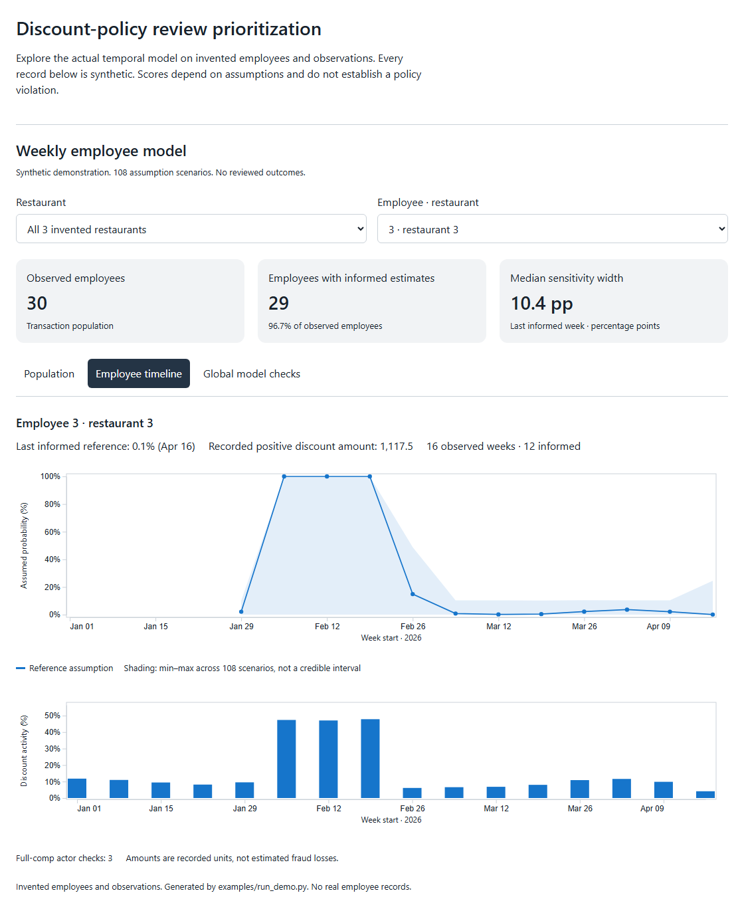
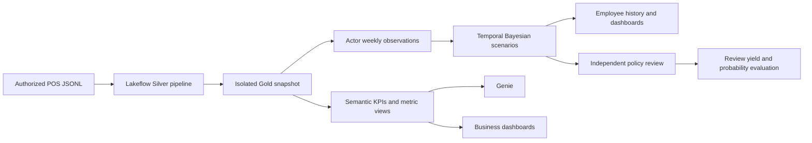

# Stark Overflow: discount-policy investigation on Databricks

Team **Stark Overflow**, Sun Holdings × Databricks × Tec de Monterrey datathon.

We turn POS transactions into auditable indicators and weekly review priorities. The business objective is **more independently verified policy-violating employee-weeks per review**, including accidental mistakes. Managers inspect the underlying discounts and applicable policies before reaching a conclusion.

**Public package:** source code, documentation and invented demonstration data. Company transactions, employee records, reference workbooks, private workspace identifiers and credentials are excluded.

## Try the synthetic demonstration

The model and dashboard run without a Databricks account:

```bash
python -m venv .venv
# Activate .venv for your shell, then:
python -m pip install -r requirements.txt
python -m unittest discover -s tests -v
python examples/run_demo.py
```

Open [dashboards/model-demo.html](dashboards/model-demo.html) after downloading/cloning the repository. The generated demo is included, so you can open it before installing Python. For a local web preview, run `python -m http.server 8000` and visit `http://localhost:8000/dashboards/model-demo.html`.

It contains **30 invented employees** across three invented restaurants. Explore population KPIs, a temporary activity spike followed by ordinary observations, persistent higher activity, missing evidence, training-only history and 108 assumption settings. The plots load D3 from a pinned public CDN; no company data service is contacted. [Three-minute walkthrough](docs/demo.md).



## What is implemented

| Component | Implementation |
| --- | --- |
| Data engineering | Fixed-schema JSONL ingestion, common check acceptance/deduplication boundary, 17 Silver outputs, decimal Gold components and per-run snapshots |
| Team fraud indicators | Employee and manager daily/weekly discount, tip and void metrics |
| Weekly model | Recorded discount-actor history, beta-binomial background fitting, normalized conditional likelihoods and temporal filtering |
| Explanation | Reference prior/posterior, coverage reasons, actual counts and unweighted sensitivity across 108 settings |
| Exploration | Public synthetic dashboard, authorized employee-history notebook, business KPI/metric-view SQL and Genie configuration |
| Independent review | Blinded probability sample, audited outcomes, precision@20 and sampling-weighted recall/probability-quality calculations |
| Reproduction | Configurable Databricks bundle, actual Job/pipeline resources, local tests and GitHub Actions |

**Current limitation:** the historical model used declared assumptions because independently reviewed violation outcomes were unavailable. Violation precision, recall and probability calibration have not been established. The review workflow calculates those measures when sufficient independently verified outcomes exist; it does not invent labels or train against an earlier risk coefficient.

## Architecture



The model runs in Lakeflow Jobs. Silver uses a Lakeflow Declarative Pipeline; Gold is a separate, isolated snapshot task. The semantic/Genie scripts remain explicit warehouse SQL operations. [Grains, lineage and ownership](docs/architecture.md).

## Weekly model

The target is at least one positive discount applied by the **recorded discount actor** in an employee–restaurant–Thursday week that violated an applicable policy, including a mistake. This is distinct from the first-payment owner used by the team's general employee indicator tables.

`K` positive-discount checks among `N` eligible opportunities form one count observation. Four earlier complete weeks fit an unlabeled restaurant background. Hypothetical conditional distributions and temporal transitions update each later week. Incomplete observations retain a predicted prior, training weeks have no estimate, and missing calendar weeks are not invented as clean records.

The reference assumes a 5% weekly base rate, one-week memory half-life and 2× activity odds under the hypothetical violation state. The full 108-setting grid tests weaker, stronger and contrary assumptions. These settings are not empirically estimated fraud prevalence. **The sensitivity envelope is not a posterior credible interval.** [Full model card](docs/model-card.md).

## Evidence and evaluation

The executed development model covered **3,174 observed employee histories and 34,342 actor-location-weeks**. On 22,914 later eligible count observations, beta-binomial mean log predictive score was approximately **−2.596**, compared with **−2.868** for the binomial comparator; higher is better. This assesses discount-count prediction, not verified violation detection.

The independent review setup prepared 66 cases with 927 positive-discount-check evidence records and zero reviewed outcomes at setup. Its comparison baseline is positive-discount frequency; it is not the unlocated original Gold risk coefficient. No measured financial savings or confirmed employee misconduct is claimed.

The public portable wrappers are an adaptation of that executed workflow. Local tests, a synthetic demo and bundle validation are separate from a fresh end-to-end cloud run. [Results and verification scope](docs/results.md), [review protocol](docs/review-protocol.md).

## Deploy in an authorized workspace

Configure the authenticated CLI profile, authorized source volume and dedicated output namespaces outside Git:

```bash
databricks bundle validate --profile YOUR_PROFILE --var source_root=/Volumes/YOUR_CATALOG/YOUR_SCHEMA/YOUR_VOLUME
databricks bundle plan --profile YOUR_PROFILE --var source_root=/Volumes/YOUR_CATALOG/YOUR_SCHEMA/YOUR_VOLUME
```

After reviewing the plan, deploy and run `weekly_model`. Its tasks are Silver refresh → Gold snapshot → actor preparation → weekly scoring. `review_pilot` is a separate on-demand Job requiring a completed model run. No schedule is configured. Ownership guards remain active; personal hostnames, profiles, identities and run IDs are not committed. [Deployment guide](docs/deployment.md).

## Repository map

```text
config/                           Declared scenario and synthetic parameters
examples/run_demo.py               Reproducible synthetic model/dashboard
dashboards/                       Dashboard source, demo and authorized SQL queries
src/transformations/silver/        Typed ingestion and accepted transaction/dimension SQL
src/transformations/gold/base/     Check facts, discount events and restaurant-day SQL
src/transformations/gold/fraud/    Team employee/manager indicators and documentation
src/models/                       Count/temporal/review logic and ownership boundaries
src/semantic/                     Team copy layer, dimensions, KPIs and metric views
notebooks/                        Portable Gold, actor, scoring, history and review tasks
resources/                        Actual pipeline and Job definitions
genie/                            Team Genie instructions, examples and benchmarks
tests/                            Numerical, review, ownership and portability checks
docs/                             Model card, results, deployment and judge walkthrough
```

## Business indicators and semantic layer

The team's employee indicators include discount ratio/frequency, full comps, discount-and-void checks, card tip/no-tip contrasts, cash/no-tip contrasts and void measures. Manager indicators include approval ratio, self-approval, approval concentration, approved voids and comparison with peers. They are investigative signals; only the activity-count block is a likelihood input in the current model.

Checks use `(location_id,business_date,check_id)`. Fraud weeks run Thursday–Wednesday. ID 0 is unspecified. Weekly ratios use weekly sums, never averages of daily ratios. Monetary display uses recorded units; currency has not been confirmed.

The semantic catalog contains dimensions, KPI tables and metric views for sales, discounts, tips, voids and employee/manager indicators. Genie instructions and benchmarks live in `genie/space_config.py`. Preserve source lineage outside those business-friendly copies.

Semantic build order: `src/semantic/00`–`03`, then `04`–`06`, employee/manager fraud day scripts, their week scripts, `fraud_comments.sql`, then `07_semantic_fraud.sql`. Company reference files are an external prerequisite. The SQL runner accepts explicit `catalog`, `source_silver_schema`, `source_gold_schema`, `source` and `target` variables; dry runs make no remote calls. See [deployment examples](docs/deployment.md).

## Team

Stark Overflow combines POS data engineering, business indicators/semantic modeling, Genie, temporal modeling, independent-review evaluation and visualization. Existing team contributions are retained; contributor history is available in [GitHub contributors](https://github.com/Mmateo101/databricks-sun-holdings-stark-overflow/graphs/contributors).
