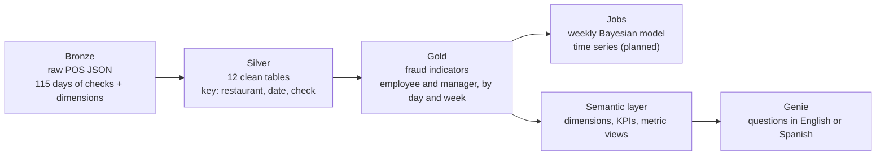

# Applebee's Fraud Detection on Databricks

**Team Stark Overflow** · Sun Holdings × Databricks × Tec de Monterrey datathon
Luis Ernesto Colunga Lozano · Mateo Rodolfo Flores Torres · Miguel Angel Villanfuerte Villareal

A comprehensive study of fraudulent discount behavior in Applebee's restaurants. We turn raw point-of-sale (POS) checks into a medallion architecture in Databricks, measure how every employee and manager uses discounts, and follow each of them week after week to find behavior worth reviewing.

> This public repository contains code and documentation only. Company transactions, employee records, reference workbooks and workspace identifiers stay inside Databricks.

## 1. The question: what does fraud look like in a restaurant?

Before looking at any data we asked which behaviors would be suspicious. We arrived at three signals:

| # | Signal | Why it is suspicious |
|---|---|---|
| 1 | **Higher discounts over sales** | An employee who gives far more discount than others may be giving food away or keeping the difference. |
| 2 | **Discounts that come with cash or no tip** | Cash leaves no trace. A discount followed by a cash payment is the classic way to pocket money. |
| 3 | **Bigger card tips when there is a discount** | The guest pays the full amount and the discount ends up in the tip. |

## 2. Objective

For **each employee**, measure these three signals and compare them:

- **against their peers**: is this employee different from the others in the same restaurant?
- **against themselves over time**: is this week different from their own history?

The same idea is then applied to **managers**, who approve discounts and voids.

## 3. Medallion architecture



| Layer | What it holds | Where |
|---|---|---|
| **Bronze** | Raw JSON files: one folder per day of checks (115 days) plus employees, items, locations and revenue centers. | `src/transformations/silver/01_inputs.sql` (private streaming tables) |
| **Silver** | 12 tables joined by the check key `(location_id, business_date, check_id)`: `checks`, `check_items`, `payments`, `discount_events`, `discount_types`, `voids`, `taxes`, `employees`, `items`, `locations`, `revenue_centers`, `quality_issues`. | `src/transformations/silver/` (Lakeflow pipeline) |
| **Gold** | Check facts and the employee and manager fraud tables, by day and by week. | `src/transformations/gold/` |
| **Semantic** | Catalog `applebees_semantic`: dimensions, KPI tables, 6 metric views and discount reference data for Genie. | `src/transformations/gold/semantic/` |

## 4. Gold: the employee fraud table

Every gold table has three kinds of columns:

- **Informative**: who, where and when (`week_start`, `employee_id`, `location_id`, `days_worked`).
- **Auxiliary**: the numerator and the denominator of every ratio, each kept as its own column.
- **Ratios**: the signals themselves.

| Ratio | Definition | Reading |
|---|---|---|
| `discount_ratio` | discount amount ÷ gross sales | Share of sales given away. |
| `cash_ratio` | share of discounted checks paid in cash or with no tip ÷ the same share on checks without a discount | Above 1: discounts come with cash. |
| `tip_ratio` | tip rate on discounted card checks (over the bill *before* the discount) ÷ the same rate on card checks without a discount, weighted by sales | Honest discounts give about 0.8; above 1 is a red flag. |

The same table has complementary indicators: discount frequency, full-comp ratio, discount-and-void checks, card checks with no tip, and voids per 100 checks.

**Day first, then week.** `fraud_employee_day` has one row per employee and day; a check belongs to the employee who took its first payment. `fraud_employee_week` groups the days into weeks that run **Thursday to Wednesday**, sums the numerators and denominators, and recomputes each ratio. Daily ratios are never averaged. Result: **34,256 employee-weeks for 3,158 employees**.

## 5. Managers

Managers approve discounts and voids, so they get five indicators of their own:

| # | Indicator | Meaning |
|---|---|---|
| 1 | Approval ratio | Approved discounts ÷ store sales. |
| 2 | Self-approval | Share of approvals on discounts they applied themselves. |
| 3 | Concentration | Share of their approvals that go to one single employee. |
| 4 | Approved voids | Voids they approve per 100 checks. |
| 5 | Vs. peers | Approved amount compared with the average manager of the same store. |

Same process: `fraud_manager_day` summed into `fraud_manager_week`. Result: **9,450 manager-weeks for 854 managers**.

## 6. Jobs: following every employee week after week

### Weekly Bayesian model

For every employee and every week, the model updates the probability that the week contains a discount-policy violation, starting from the previous week's answer:

```text
P(violation | this week's data)  ∝  P(data | violation) · P(violation | last week)
```

- **Usual behavior** is fitted per restaurant on the first four complete weeks (beta-binomial).
- **Memory** between weeks is a two-state chain. With the reference settings, a violation continues into the next week with probability 0.525 and starts with probability 0.025.
- **Sensitivity**: the model runs under 108 assumption settings (base rate, memory, effect size, concentration), so a reviewer sees how much each result depends on them.

Current scope, stated plainly:

- Today the model's evidence is the **weekly discount count**: discounted checks K out of eligible checks N. Adding the cash and tip ratios is the next step.
- Its target is a *policy violation, including honest mistakes*, not proven fraud. No independently reviewed cases exist yet, so the probabilities are **not calibrated**. They rank weeks for review; they do not accuse anyone.
- On 22,914 later employee-weeks, the beta-binomial predicted discount counts better than a plain binomial (mean log predictive score −2.596 vs −2.868, higher is better).

The model credits each discount to the employee *recorded as applying it*, while the gold tables use the employee who took the first payment. That is why the model covers 34,342 employee-location-weeks for 3,174 employees, slightly more than the gold table.

### Time series (planned)

A per-employee time series to tell whether each employee is rising or falling against their own history.

## 7. Semantic layer and Genie

The catalog `applebees_semantic` holds the final silver and gold tables, a `reference` schema with the meaning of each discount code, and a `semantic` schema with dimensions, KPIs and six metric views. Every metric is defined once and documented.

On top of it, the Genie space **Applebee's Discount & Fraud Analyst** answers questions about discounts, tips and voids in English or Spanish, for example *"Which managers approve their own discounts?"*. Its instructions, example queries and benchmarks are in `src/transformations/gold/semantic/genie_space.py`.

## 8. Repository structure

The repository follows the Sun Holdings Databricks template: orchestration in `resources/`, table logic in `src/transformations/`.

```text
├── databricks.yml                        Bundle: variables, includes, dev target
├── requirements.txt                      numpy / scipy for the model
├── resources/
│   ├── jobs/
│   │   └── weekly_fraud_model.yml        Silver refresh → gold snapshot → employee weeks → weekly scoring
│   └── pipelines/
│       └── silver_pipeline.yml           Lakeflow pipeline for the silver layer
└── src/
    ├── transformations/
    │   ├── run_sql.py                    Runs the warehouse SQL below with explicit variables
    │   ├── silver/                       Lakeflow SQL: raw inputs, check acceptance, transactions, dimensions, quality
    │   └── gold/
    │       ├── check_facts.sql           One row per accepted check
    │       ├── discount_events.sql       One row per discount
    │       ├── location_day.sql          Restaurant totals per day
    │       ├── fraud_employee_day.sql    Employee indicators by day
    │       ├── fraud_employee_week.sql   Employee indicators by week (Thu–Wed)
    │       ├── fraud_manager_day.sql     Manager indicators by day
    │       ├── fraud_manager_week.sql    Manager indicators by week
    │       ├── fraud_comments.sql        Table and column documentation (generated by build_fraud_comments.py)
    │       ├── build_gold.py             Job notebook: isolated gold snapshot for the model
    │       └── semantic/                 Catalog, silver/gold copies, reference, dimensions, KPIs, metric views, Genie
    └── models/                           Weekly Bayesian model: notebooks, SQL and Python
```

## 9. How to run it

### Pipeline and model job

Authenticate the Databricks CLI with your own profile and point `source_root` to the volume with the raw JSON (`checks/`, `dimensions/employees/`, `dimensions/items/`, `dimensions/locations/`, `dimensions/revenue_centers/`):

```bash
databricks bundle validate --profile YOUR_PROFILE --var source_root=/Volumes/CATALOG/SCHEMA/VOLUME
databricks bundle deploy --profile YOUR_PROFILE --var source_root=/Volumes/CATALOG/SCHEMA/VOLUME
databricks bundle run weekly_model --profile YOUR_PROFILE --var source_root=/Volumes/CATALOG/SCHEMA/VOLUME
```

The job runs on demand; no schedule is configured yet. Silver, gold snapshots and model outputs go to dedicated schemas named after the deploying user, so existing team tables are never overwritten.

### Gold fraud tables and semantic layer

These scripts run on a SQL warehouse through `run_sql.py`. Set `DATABRICKS_WAREHOUSE_ID`, then run them in this order (all paths under `src/transformations/`). Use `--dry-run` first to check the variable substitution without touching the workspace.

1. `gold/semantic/00_catalog.sql`, `01_silver_copy.sql`, `02_gold_copy.sql`, `03_reference.sql`
2. `gold/semantic/04_dimensions.sql`, `05_kpis.sql`, `06_metric_views.sql`
3. `gold/fraud_employee_day.sql` and `gold/fraud_manager_day.sql`, then their `_week` scripts (each takes `--var target=...`, and the week scripts also `--var source=...`)
4. `gold/fraud_comments.sql`, then `gold/semantic/07_fraud.sql`

```bash
python src/transformations/run_sql.py src/transformations/gold/semantic/00_catalog.sql --dry-run \
  --var catalog=applebees_semantic --var source_silver_schema=CATALOG.SILVER_SCHEMA --var source_gold_schema=CATALOG.GOLD_SCHEMA
```

`03_reference.sql` needs the company discount workbook, exported as CSV, in `/Volumes/<catalog>/reference/uploads/`. It is not distributed here.

## 10. Data rules

- A check is identified by `(location_id, business_date, check_id)`; `check_id` alone repeats across restaurants and days.
- Fraud weeks run Thursday to Wednesday.
- Employee or manager ID 0 means "not specified" and is left out.
- Weekly ratios are recomputed from weekly sums, never averaged from daily ratios.
- Amounts are in source currency units; the currency has not been confirmed.

## 11. Next steps

1. Keep building the **dashboards** on top of the semantic layer.
2. Improve the **Bayesian model**: add the cash and tip ratios as evidence and calibrate it with independently reviewed cases.
3. Build and tune the per-employee **time series**.
4. Bring the **manager** indicators into the weekly jobs.
