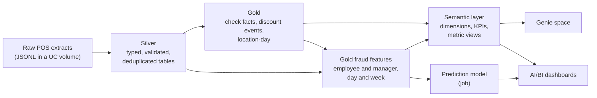

# Stark Overflow: Discount Fraud Detection on Databricks

Team **Stark Overflow** solution for the *Sun Holdings × Databricks × Tec de Monterrey* challenge: detect possible discount, void and tip fraud by employees and managers in Applebee's restaurants using point-of-sale (POS) data.

> **Data notice.** This repository contains code and documentation only. No business data, workspace identifiers or credentials are stored here; all data stays inside the Databricks workspace.

## Contents

- [Architecture](#architecture)
- [Repository structure](#repository-structure)
- [Medallion layers](#medallion-layers)
- [Business rules](#business-rules)
- [Fraud indicators](#fraud-indicators)
- [Semantic layer and Genie](#semantic-layer-and-genie)
- [Dashboards](#dashboards)
- [Prediction model](#prediction-model)
- [How to deploy](#how-to-deploy)
- [Team](#team)

## Architecture



Everything runs on Databricks: Lakeflow Declarative Pipelines for silver and gold, Unity Catalog for governance, metric views for the semantic layer, Genie for natural-language questions, AI/BI dashboards and Lakeflow Jobs for orchestration.

## Repository structure

```
.
├── databricks.yml              # Databricks Asset Bundle definition
├── resources/
│   ├── jobs/                   # Job definitions, schedules and task orchestration
│   └── pipelines/              # Lakeflow pipeline configuration
├── src/
│   ├── transformations/
│   │   ├── silver/             # Raw ingestion, validation and cleaned tables
│   │   └── gold/               # Business-ready tables and fraud features
│   ├── semantic/               # Dimensions, KPI tables and metric views
│   └── models/                 # Fraud prediction model
├── genie/                      # Genie space definition (instructions, examples, benchmarks)
└── dashboards/                 # AI/BI dashboard definitions
```

## Medallion layers

### Raw
POS extracts land as JSONL files in a Unity Catalog volume, partitioned by date: checks (with nested items, discounts, payments, taxes and voids) and the employee, item, location and revenue center dimensions.

### Silver
_To be completed with the pipeline code._ Streaming ingestion with a fixed typed schema, record acceptance and quality rules, and one cleaned table per entity: checks, check items, item and check discounts, payments, voids, taxes, discount events, employees, items, locations and revenue centers, plus quality review tables.

### Gold
_To be completed with the pipeline code._ Business-ready tables:

| Table | Grain | Purpose |
|---|---|---|
| `check_facts` | check | Gross sales, discounts and discount-rate eligibility per check |
| `discount_events` | discount application | Who applied and who approved each discount |
| `location_day` | restaurant × day | Daily sales and discount totals |
| `fraud_employee_day` / `_week` | employee × restaurant × day / week | Employee fraud indicators |
| `fraud_manager_day` / `_week` | manager × restaurant × day / week | Manager fraud indicators |

## Business rules

- A check is identified by `(location_id, business_date, check_id)`.
- The **check owner** is the first employee who took a payment on it; gift card sales are excluded.
- **Card payments** are credit cards plus online ordering payments.
- The **fraud week** runs Thursday to Wednesday.
- Employee or manager ID `0` means "not specified" in the POS.
- Weekly ratios are recomputed from weekly sums, never averaged from daily ratios.

## Fraud indicators

### Employees

| # | Indicator | Formula | Suspicious when |
|---|---|---|---|
| 1 | `discount_ratio` | discount amount / sales | High |
| 2 | `cash_ratio` | share of cash or no-tip checks, discounted vs. non-discounted | Above 1 |
| 3 | `tip_ratio` | card tip rate, discounted vs. non-discounted checks | Above 1 |
| 4 | `discount_frequency` | discounted checks / checks | High |
| 5 | `full_comp_ratio` | checks fully given away / checks | High |
| 6 | `discount_void_ratio` | checks with a discount and a void / checks | High |
| 7 | `card_no_tip_ratio` | share of card checks with no tip, discounted vs. non-discounted | Above 1 |
| 8 | `voids_per_100_checks`, `void_ratio` | voided items per 100 checks, voided amount / sales | High |

### Managers

| # | Indicator | Formula | Suspicious when |
|---|---|---|---|
| 1 | `approval_ratio` | approved discount amount / store sales | High |
| 2 | `self_approval_ratio` | discounts the manager both applied and approved / approvals | Above 0 |
| 3 | `concentration_ratio` | approvals to the most-approved employee / approvals | High |
| 4 | `approved_voids_per_100_checks` | approved voids per 100 store checks | High |
| 5 | `approval_vs_peers` | approved amount vs. the average manager of the same store and period | Well above 1 |

_Each indicator is a signal to review, not proof of fraud._

## Semantic layer and Genie

A separate catalog (`applebees_semantic`) holds clean copies of the final silver and gold tables plus a `semantic` schema with documented dimensions (restaurant, channel, employee, discount code, calendar), KPI tables and metric views for sales and discounts, discount usage, card tips, voids and the employee and manager fraud indicators. Every table and column has an English comment, plus primary/foreign keys and tags, so Genie can answer questions in natural language.

The Genie space is defined in `genie/space_config.py` with instructions, example queries and benchmark questions.

### Build order

Scripts run statement by statement on a SQL warehouse with `tools/run_sql.py`:

```bash
export DATABRICKS_WAREHOUSE_ID=<your-warehouse-id>
python3 tools/run_sql.py src/semantic/00_catalog.sql src/semantic/01_silver_copy.sql \
  src/semantic/02_gold_copy.sql src/semantic/03_reference.sql src/semantic/04_semantic_dimensions.sql \
  src/semantic/05_semantic_kpis.sql src/semantic/06_semantic_metric_views.sql
```

| Step | Files | Builds |
|---|---|---|
| 1 | `src/semantic/00` to `03` | Catalog, schemas, silver/gold copies, reference tables |
| 2 | `src/semantic/04` to `06` | Dimensions, KPI tables, metric views |
| 3 | `src/transformations/gold/fraud/fraud_*_day.sql`, then `fraud_*_week.sql` | Employee and manager fraud tables |
| 4 | `src/transformations/gold/fraud/fraud_comments.sql` | Table and column comments (generated by `build_comments.py`) |
| 5 | `src/semantic/07_semantic_fraud.sql` | Keys, tags and the fraud metric views |
| 6 | `python3 genie/space_config.py validate` | Runs every Genie example and benchmark query |

The fraud scripts take the table names as variables, for example:

```bash
python3 tools/run_sql.py src/transformations/gold/fraud/fraud_employee_week.sql \
  --var source=applebees_semantic.gold.fraud_employee_day \
  --var target=applebees_semantic.gold.fraud_employee_week
```

The reference tables (discount dictionary, official offers, promotion calendar) are loaded from files in a Unity Catalog volume; those files are not part of this repository.

## Dashboards

_To be completed._

## Prediction model

_To be completed by the modeling team._

## How to deploy

1. Install the [Databricks CLI](https://docs.databricks.com/dev-tools/cli/install.html) and log in: `databricks auth login`.
2. Set the bundle variables (`catalog`, `source_root`, `warehouse_id`) for your workspace.
3. Validate: `databricks bundle validate`.
4. Deploy only after agreeing with the team: `databricks bundle deploy`.

## Team

_To be completed._
