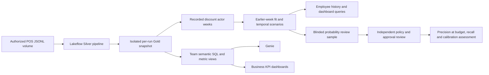

# Architecture and data contracts

## Grains and definitions

The check key is `(location_id,business_date,check_id)`. Item lines add the source item sequence; discount occurrences add scope, nullable item sequence and zero-based application ordinal. Retain multiplicity when identical applications occur twice. Array ordinals and source references are distinct concepts.

Silver uses fixed schemas, rejects ambiguous checks at one acceptance boundary, preserves lineage and typed quality flags, and exposes 17 cleaned/review outputs. Identical replays collapse to one accepted check with provenance; conflicting payloads do not become competing trusted checks. Dimensions are supplied current snapshots, not invented historical records.

Gold aggregates each child at check grain before joining. It preserves decimal gross/discount components, completeness and population denominators. Weekly ratios are recomputed from summed components, not averaged from daily ratios. The portable build notebook retains one run-specific copy of the eight Silver inputs, then computes check facts, application events and restaurant-day totals from the supplied SQL templates.

The model's positive actions follow the recorded discount actor, while activity opportunities use a disclosed payment-owner proxy. The team's daily/weekly employee and manager indicator SQL is retained separately. SQL features and semantic KPIs are useful for dashboards even when they are not observation likelihoods in the current model.

## Isolation and provenance

`weekly_model` orchestrates Silver refresh → isolated Gold snapshot → actor weeks → temporal scoring. Gold schema names include a digest of the logical Job run. Output ownership and a project marker are checked before writes. No production workspace identifiers, personal email addresses or runtime paths are committed. The executing/deploying identity is resolved at runtime.

Inputs to actor/scenario preparation pin Delta versions and record logical runs. Output tables append idempotently with transaction IDs; completion records are written last. Completed runs are the supported read boundary. A producer run is not a transaction across all of its tables, and incomplete rows must not be presented as completed outputs.

Silver materialized views cannot always be time-travelled. Keep the source pipeline quiescent while the isolated Gold copies are made. This portable workflow does not claim an atomic cross-table source snapshot. Retained per-run Delta copies provide the later model's frozen inputs; source time-travel availability still depends on retention.

The portable Gold build is an isolated research reconstruction, not a replacement for a team's existing production publication/rollback service. It creates no shared production aliases and does not automatically delete retained schemas. The semantic copy scripts can consume either the team's published Gold namespace or the isolated run namespace when explicitly configured.
